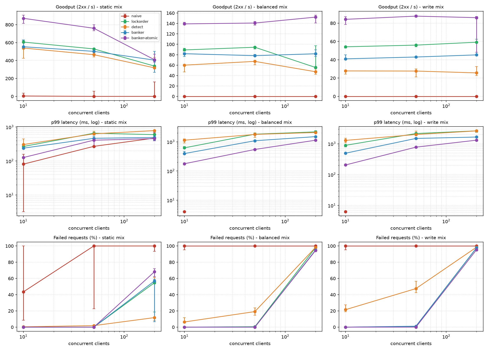

# SafeServe: Final Report

**Project:** SafeServe, a multi-threaded web server with deadlock-safe admission control
**Course:** Operating Systems
**Companions:** [`PRD.md`](PRD.md) (requirements), [`EDD.md`](EDD.md) (design, with as-built notes in §18)

---

## 1. Problem

A request to SafeServe needs several limited resources at the same time: a worker slot, buffer memory, file descriptors, a database connection and a cache write lock. When handlers take them one at a time and hold what they have while waiting for more, all four Coffman conditions can hold at once: mutual exclusion, hold-and-wait, no preemption and circular wait. The server can then deadlock.

The two routes at the centre of the study take the same pair of resources in opposite orders:

| Route | Order |
|---|---|
| `POST /upload` | … → `CLOCK` → `DB` |
| `POST /refresh` | … → `DB` → `CLOCK` |

With 4 DB connections and 2 cache locks, two uploads and four refreshes are enough. Each upload holds a `CLOCK` and waits for a `DB`; each refresh holds a `DB` and waits for a `CLOCK`.

## 2. Strategies compared

All four strategies share one set of resource tables (`Available`, `Max`, `Allocation`, `Request`) behind one mutex and condition variable (`src/rm.c`). They differ only in the grant rule:

| Mode | Coffman condition attacked | Grant rule | Waiting |
|---|---|---|---|
| `naive` | none | units free | forever |
| `lockorder` | circular wait | units free **and** requested type's index > every held type's index | bounded (`admit_timeout_ms`) → 503 |
| `detect` | none up front; recovers afterwards | units free | until granted or aborted; a detector thread aborts victims |
| `banker` | none; *avoids* unsafe states | units free **and** the state after the grant is safe | bounded → 503 |
| `banker-atomic` | hold-and-wait | whole claim at once, Banker's check | bounded → 503 |

**Banker's safety algorithm** (`src/banker.c`):
1. Set `work = Available`.
2. Repeatedly find an active request whose `Max − Allocation ≤ work`. Assume it finishes and returns its allocation: `work += Allocation`.
3. The state is safe iff every active request can finish this way.

The request algorithm tentatively grants and runs this check. Active requests are compacted first, so the cost is O(k²·m) for k in-flight requests rather than O(N_MAX²·m).

**Detection** (`src/detect.c`) is the multi-instance algorithm over the **Request** matrix. `request[i]` is non-zero only while request *i* is blocked. Requests that hold nothing, or whose current request fits in `work`, are assumed to finish. Whatever remains is deadlocked. The victim is the deadlocked request holding the fewest units (least work lost), with ties going to the youngest. It is always blocked when chosen, so taking back its resources never pulls them out from under running code.

**Fairness** (banker): FIFO among waiters plus aging. After `fairness_aging_ms`, new requests stand aside for the starved waiter (EDD §18).

## 3. Correctness evidence

| Claim | Evidence |
|---|---|
| Safety algorithm is correct | `test_banker`: Silberschatz textbook state (safe sequence ⟨P1, P3, P4, P0, P2⟩, the follow-up requests); boundary cases; **20,000 random states** compared with brute force over every ordering, for both `banker_is_safe` and `banker_can_grant`. |
| Detection is correct | `test_detect`: textbook detection example (deadlock-free, then P1–P4 deadlocked after P2's extra request); running and inactive slots never flagged; victim choice. |
| Naive really deadlocks; the others don't | `test_modes`, `make demo`, `make demo-live`, and the naive case in `tests/e2e.sh`, all on the opposite-order workload. |
| Invariants hold under concurrency | `test_rm_stress`: 24 threads × 60 requests with random acquisition order per mode. A checker thread asserts `0 ≤ available ≤ total`, `available + Σ alloc = total`, `alloc ≤ max`, and (banker) that the committed state is safe, every millisecond. |
| No data races / memory errors (NFR-1, NFR-5) | All unit tests under ThreadSanitizer, and the e2e suite plus 50-client load in three modes against a TSan-built server, with **no reports**. Unit and e2e tests under AddressSanitizer, also clean. |
| Starvation bounded (FR-17) | `test_modes`: a 4-unit claim competing with 12 threads of 1-unit claims. With aging it is granted in about 100 ms (asserted < 400 ms). Without aging it waited up to 470 ms in normal runs and timed out after 1.5 s under TSan. |
| Safety-check overhead (NFR-3) | `test_banker`: about **1 µs** per check with 64 in-flight requests × 8 resource types over the full 1,024-slot table (target < 100 µs). |

## 4. Evaluation

### 4.1 Setup

* **Machine and parameters** (from `results/bench_meta.txt`):
  ```
  date: 2026-10-23T16:15:00Z
  host: Darwin 23.5.0 arm64
  cpus: 8
  modes: naive lockorder detect banker banker:atomic
  mixes: static balanced write
  clients: 10 50 200
  duration_s: 6 warmup_s: 2 reps: 3 seed: 1
  ```
* **Server:** default config. 16 workers, queue of 128, `admit_timeout_ms` 2000, `queue_timeout_ms` 1000. Simulated work: DB 50 ms, upload 30 ms, refresh 40 ms, 50 ms between the last two acquisitions.
* **Client:** `bin/loadgen` runs closed-loop clients with fixed seeds. Each request has a 3 s deadline covering connect, send and response; missing it counts as a **timeout**. A fresh server and port are used for every run. Latency percentiles cover **successful** requests only; failures are counted separately.
* **Workload mixes** (static / query / upload / refresh %):

  | Mix | Static | Query | Upload | Refresh |
  |---|---:|---:|---:|---:|
  | `static` | 90 | 6 | 2 | 2 |
  | `balanced` | 40 | 30 | 15 | 15 |
  | `write` | 10 | 30 | 30 | 30 |
* **Strategies:** the four modes with incremental admission, plus `banker-atomic` (whole claim reserved up front).
* **Reproduce:** `REPS=3 DURATION=6 WARMUP=2 make bench && make plot`.

Runs are 6 s after a 2 s warm-up, 3 repetitions per cell, on a laptop that also runs the client. That is shorter than the EDD's 60 s × 5 protocol, so treat differences under about 10% as noise. The script supports the full protocol (`REPS=5 DURATION=60`).



### 4.2 Results (median of 3 runs)

| Mix | Clients | Strategy | Goodput (2xx/s) | p50 ms | p99 ms | Failed % | Timeouts |
|---|---:|---|---:|---:|---:|---:|---:|
| static | 10 | naive | 4.3 | 1 | 81 | 43 | 20 |
| static | 10 | lockorder | 606.0 | 1 | 268 | 0 | 0 |
| static | 10 | detect | 539.5 | 1 | 306 | 0 | 0 |
| static | 10 | banker | 553.8 | 2 | 240 | 0 | 0 |
| static | 10 | banker-atomic | 871.0 | 1 | 127 | 0 | 0 |
| static | 50 | naive | 0.0 | 55 | 271 | 100 | 100 |
| static | 50 | lockorder | 529.7 | 64 | 659 | 0 | 0 |
| static | 50 | detect | 465.3 | 62 | 631 | 2 | 0 |
| static | 50 | banker | 502.5 | 57 | 465 | 0 | 0 |
| static | 50 | banker-atomic | 760.2 | 41 | 411 | 0 | 0 |
| static | 200 | naive | 0.0 | 141 | 474 | 100 | 400 |
| static | 200 | lockorder | 337.8 | 142 | 598 | 55 | 318 |
| static | 200 | detect | 318.5 | 133 | 785 | 12 | 229 |
| static | 200 | banker | 404.5 | 82 | 494 | 57 | 337 |
| static | 200 | banker-atomic | 408.8 | 123 | 457 | 68 | 385 |
| balanced | 10 | naive | 0.0 | 4 | 4 | 100 | 20 |
| balanced | 10 | lockorder | 89.2 | 81 | 623 | 0 | 0 |
| balanced | 10 | detect | 60.0 | 66 | 1139 | 6 | 0 |
| balanced | 10 | banker | 82.0 | 105 | 397 | 0 | 0 |
| balanced | 10 | banker-atomic | 139.2 | 94 | 178 | 0 | 0 |
| balanced | 50 | naive | 0.0 | - | - | 100 | 100 |
| balanced | 50 | lockorder | 94.3 | 444 | 1827 | 1 | 0 |
| balanced | 50 | detect | 67.2 | 478 | 1796 | 19 | 0 |
| balanced | 50 | banker | 78.2 | 645 | 1091 | 0 | 0 |
| balanced | 50 | banker-atomic | 140.8 | 379 | 548 | 0 | 0 |
| balanced | 200 | naive | 0.0 | - | - | 100 | 75 |
| balanced | 200 | lockorder | 55.5 | 988 | 2199 | 98 | 293 |
| balanced | 200 | detect | 47.3 | 949 | 2089 | 98 | 308 |
| balanced | 200 | banker | 81.8 | 1079 | 1507 | 95 | 174 |
| balanced | 200 | banker-atomic | 152.2 | 876 | 1139 | 94 | 153 |
| write | 10 | naive | 0.0 | 6 | 6 | 100 | 20 |
| write | 10 | lockorder | 54.2 | 125 | 892 | 0 | 0 |
| write | 10 | detect | 27.8 | 207 | 1287 | 21 | 0 |
| write | 10 | banker | 41.0 | 251 | 495 | 0 | 0 |
| write | 10 | banker-atomic | 84.2 | 135 | 206 | 0 | 0 |
| write | 50 | naive | 0.0 | - | - | 100 | 97 |
| write | 50 | lockorder | 56.0 | 753 | 2148 | 1 | 0 |
| write | 50 | detect | 27.7 | 835 | 1995 | 47 | 1 |
| write | 50 | banker | 43.0 | 1145 | 1489 | 1 | 0 |
| write | 50 | banker-atomic | 87.7 | 599 | 778 | 0 | 0 |
| write | 200 | naive | 0.0 | - | - | 100 | 17 |
| write | 200 | lockorder | 59.2 | 1092 | 2629 | 98 | 119 |
| write | 200 | detect | 25.7 | 1083 | 2618 | 99 | 115 |
| write | 200 | banker | 45.3 | 1344 | 1654 | 98 | 118 |
| write | 200 | banker-atomic | 86.0 | 1132 | 1310 | 95 | 155 |

### 4.3 Findings

1. **Naive deadlocks under every mix.** With any upload/refresh traffic, goodput falls to 0 and every request times out. Even the static-heavy mix (4% conflicting requests) freezes at 50 clients.
   - The deadlocked requests hold all `DB` connections, so every later `/query` blocks forever too.
   - Within seconds all 16 workers are stuck and the server stops serving even static files. This is the "stall spreads until the whole server is unresponsive" scenario from PRD §2.
   - Across the whole sweep: 2,551 client timeouts and 1,557 successes out of 1.35 M attempts.
   - The other strategies **never deadlocked** in any run.

2. **Banker's (incremental) costs throughput relative to lock ordering.**

   | Mix | Banker goodput vs lockorder (10 and 50 clients) |
   |---|---|
   | `static` | 5–9 % lower |
   | `balanced` | 8–17 % lower |
   | `write` | 23–24 % lower |

   All of these are inside the PRD's 25% target (NFR-4), though `write` is at the edge. The cause is conservatism: Banker's refuses grants that would leave *some* request unable to finish in the worst case, even when that worst case never happens. In return Banker's has the **lowest p99 among the incremental strategies**, e.g. `write`/50: 1.49 s vs 2.15 s (lockorder) and 2.00 s (detect). Waiting happens up front, before a request holds anything, rather than midway while holding resources others need.

3. **Detection and recovery pays for deadlocks after they happen.** It has the lowest goodput of the working strategies in every mix with conflicts (`write`: 26–28 req/s, about half of lockorder). It also loses requests: 21–47% of `write` requests end in 503 because they were aborted as victims, after doing part of their work.
   - The "fewest units held" victim policy sometimes picks a request that doesn't hold the contended resource, so several victims are needed to break one deadlock (in `test_rm_stress`, over 40% of requests were aborted).
   - A policy aware of the contended resource would waste less work.

4. **Reserving the whole claim up front (`banker-atomic`) is the fastest strategy here**: about 1.6× lockorder's goodput (`balanced`/50: 141 vs 94 req/s; `write`/50: 88 vs 56) with the lowest p99 (0.55–0.78 s at 50 clients).
   - Taking everything at once removes hold-and-wait, so nothing ever sits holding a DB connection while waiting for a cache lock.
   - The cost is generality: atomic reservation only works when a handler can name its whole claim before it starts, and it holds every resource for the request's full duration.
   - In this workload, claims are small and requests are short, so that cost is low. Incremental Banker's matters when the acquisition order or timing is decided at run time.

5. **At 200 clients the server is overloaded, by design.** 200 closed-loop clients against 16 workers. Every strategy rejects most requests (`503` from the full queue or the queue deadline, plus connect timeouts when the 128-entry listen backlog overflows).
   - The point of this row is that **goodput holds steady** instead of collapsing. Before `queue_timeout_ms` was added, goodput fell to 0 in every mode at this load (EDD §18).
   - Failures at this level reflect capacity, not deadlock handling.

6. **The admission controller is cheap.** In the server, Banker's checks averaged about 0.3 µs (`/metrics` → `avg_safety_check_us`), and the NFR-3 micro-benchmark measures about 1 µs for 64 requests × 8 resource types. The throughput gap in finding 2 comes from *refusing* grants, not from computing the check.

### 4.4 PRD success metrics

| Metric (PRD §8) | Target | Result |
|---|---|---|
| Deadlocks in SafeServe mode | 0 | 0 in all banker runs, tests and demos |
| Naive deadlock reproduced | Deterministically | Yes: `make demo`, `make demo-live`, e2e test, every naive benchmark cell |
| Safety algorithm tests | 100% pass incl. textbook | Pass, plus 20,000-state brute-force comparison |
| Admission overhead | Reported, < 100 µs | ~0.3 µs (server), ~1 µs (64 × 8 micro-benchmark) |
| Tail latency under overload | ≤ admit timeout + service time | Banker p99 ≤ 1.66 s in every cell (admit timeout 2 s) |
| Evaluation completeness | 4 strategies × ≥ 3 mixes × ≥ 3 levels | 5 configurations × 3 mixes × 3 levels × 3 reps |

## 5. Limitations

* **Simulated work.** The DB, upload and refresh work are fixed delays. Contention and holding times are real, but absolute throughput says nothing about a real database.
* **Short runs, one machine.** Runs are short and the client shares the machine with the server (EDD §12 asks for 60 s × 5 and core pinning). The relative ordering of the strategies was stable across repetitions; small differences are not significant.
* **Static claims.** Banker's needs each route's maximum claim in advance. A wrong claim is caught (`500`) rather than handled.
* **Detection victim policy** (finding 3) is the simple one from the design, not a tuned one.
* **No keep-alive.** Every request opens a new connection, which raises connection-handling cost at high client counts.

## 6. Conclusion

| Strategy | Outcome on this workload |
|---|---|
| None (naive) | Freezes the whole server within seconds |
| Prevention (lockorder) | Highest throughput of the incremental strategies, but every handler must follow a global order |
| Detection (detect) | Keeps the server alive, but loses about half its throughput and many requests to aborts |
| Avoidance (banker) | Zero deadlocks with arbitrary acquisition orders and the best tail latency of the incremental strategies, for 5–24% less throughput than lock ordering, at about 1 µs per decision |
| Up-front reservation (banker-atomic) | Best of all, where a request can state its whole claim before starting |
